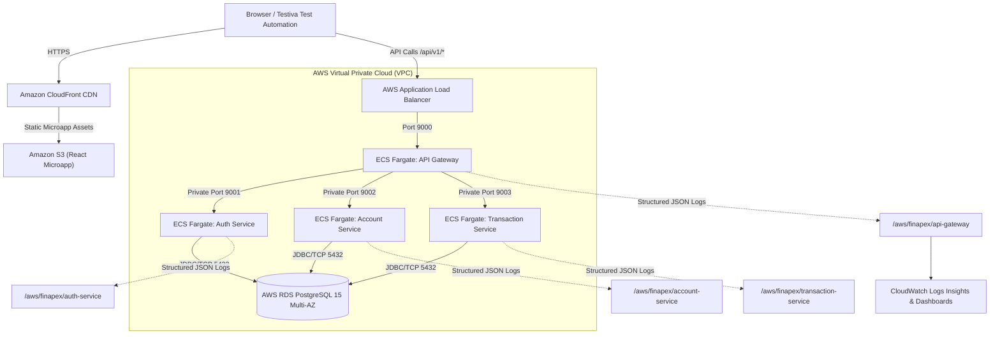

# FinApex Digital Banking - AWS Deployment & CloudWatch Architecture Guide

This comprehensive guide details the step-by-step production deployment of the **FinApex Microservices & Microapp Banking Suite** to Amazon Web Services (AWS) with real-time observability in AWS CloudWatch and automated testing using Testiva.

---

## 1. High-Level AWS Architecture



---

## 2. Relational Database Deployment (AWS RDS PostgreSQL)

### Step 2.1: Provision RDS Instance via AWS CLI
```bash
aws rds create-db-instance \
    --db-instance-identifier finapex-postgres-db \
    --db-instance-class db.t4g.medium \
    --engine postgres \
    --engine-version 15.4 \
    --allocated-storage 50 \
    --storage-type gp3 \
    --master-username finapex_admin \
    --master-user-password "SecretBankPassword2026!" \
    --db-name finapex_db \
    --vpc-security-group-ids sg-0123456789abcdef0 \
    --backup-retention-period 7 \
    --multi-az
```

### Step 2.2: Apply Schema (DDL) and Seed Data (DML)
Once RDS status is `available`:
```bash
# Connect to RDS host and apply database/schema.sql
psql -h finapex-postgres-db.cr1234.us-east-1.rds.amazonaws.com -U finapex_admin -d finapex_db -f ../database/schema.sql

# Seed pre-configured test fixtures
psql -h finapex-postgres-db.cr1234.us-east-1.rds.amazonaws.com -U finapex_admin -d finapex_db -f ../database/seed_data.sql
```

---

## 3. AWS CloudWatch Log Groups & Metric Filters

### Step 3.1: Create Dedicated Log Groups
```bash
aws logs create-log-group --log-group-name /aws/finapex/api-gateway
aws logs create-log-group --log-group-name /aws/finapex/auth-service
aws logs create-log-group --log-group-name /aws/finapex/account-service
aws logs create-log-group --log-group-name /aws/finapex/transaction-service

# Set 30-day retention policy
aws logs put-retention-policy --log-group-name /aws/finapex/api-gateway --retention-in-days 30
aws logs put-retention-policy --log-group-name /aws/finapex/transaction-service --retention-in-days 30
```

### Step 3.2: Create Metric Filters for Critical Business Events
Extract transfer failures for real-time CloudWatch Alarms:
```bash
aws logs put-metric-filter \
  --log-group-name /aws/finapex/transaction-service \
  --filter-name TransferFailures \
  --filter-pattern '{ $.level = "WARN" && $.errors[0].field = "*" }' \
  --metric-transformations \
      metricName=TransferValidationErrorCount,metricNamespace=FinApex/Transactions,metricValue=1
```

### Step 3.3: CloudWatch Logs Insights Queries
To query correlation-traced transactions in CloudWatch Insights console:
```sql
fields @timestamp, correlationId, service, action, details.amount, details.status
| filter service = "transaction-service"
| sort @timestamp desc
| limit 50
```

---

## 4. Containerization & AWS ECS Fargate Deployment

### Step 4.1: Build and Push Docker Images to Amazon ECR
```bash
# Log in to Amazon ECR
aws ecr get-login-password --region us-east-1 | docker login --username AWS --password-stdin 123456789012.dkr.ecr.us-east-1.amazonaws.com

# Build and Push Backend Microservices Image
cd services
docker build -t finapex-backend:latest .
docker tag finapex-backend:latest 123456789012.dkr.ecr.us-east-1.amazonaws.com/finapex-backend:latest
docker push 123456789012.dkr.ecr.us-east-1.amazonaws.com/finapex-backend:latest
```

### Step 4.2: Register ECS Task Definition
```bash
aws ecs register-task-definition --cli-input-json file://ecs-task-definition.json
```

### Step 4.3: Deploy ECS Service Behind ALB
```bash
aws ecs create-service \
    --cluster finapex-production-cluster \
    --service-name finapex-microservices-svc \
    --task-definition finapex-microservices-task \
    --desired-count 2 \
    --launch-type FARGATE \
    --network-configuration "awsvpcConfiguration={subnets=[subnet-abc1,subnet-abc2],securityGroups=[sg-finapex-ecs],assignPublicIp=ENABLED}" \
    --load-balancers "targetGroupArn=arn:aws:elasticloadbalancing:us-east-1:123456789012:targetgroup/tg-finapex-gateway/1234,containerName=api-gateway,containerPort=9000"
```

---

## 5. Frontend Microapp Deployment (S3 + CloudFront)

```bash
cd frontend
npm run build

# Sync built assets to S3
aws s3 sync dist/ s3://finapex-banking-microapp-prod/ --delete

# Invalidate CloudFront CDN Cache
aws cloudfront create-invalidation --distribution-id E123456EXAMPLE --paths "/*"
```

---

## 6. Automated Testing with Testiva

All UI inputs, buttons, status indicators, and modals are equipped with standardized `data-testid` attributes and dynamic locator healing support.

### 6.1 Recommended Test Matrix for Testiva:
1. **Login Positive Test:**
   - Input `[data-testid="input-login-email"]` -> `john.doe@bank.com`
   - Input `[data-testid="input-login-password"]` -> `Password123!`
   - Click `[data-testid="btn-login-submit"]`
   - Assert `[data-testid="total-net-balance"]` is visible.
2. **Transfer Negative Validation Test (Over limit):**
   - Navigate: Click `[data-testid="nav-transfers"]`
   - Input `[data-testid="input-target-account"]` -> `4491029384`
   - Input `[data-testid="input-routing-number"]` -> `021000021`
   - Input `[data-testid="input-transfer-amount"]` -> `15000` (exceeds $10k limit)
   - Input `[data-testid="input-transfer-remarks"]` -> `Test Limit`
   - Click `[data-testid="btn-transfer-submit"]`
   - Assert `[data-testid="error-transfer-amount"]` contains *"Amount exceeds maximum daily limit"*.
3. **Bill Payment Positive Test:**
   - Navigate: Click `[data-testid="nav-bills"]`
   - Select Electricity category `[data-testid="btn-cat-electricity"]`
   - Input `[data-testid="input-consumer-number"]` -> `ELEC-982341`
   - Input `[data-testid="input-bill-amount"]` -> `125.00`
   - Click `[data-testid="btn-pay-bill-submit"]`
   - Assert `[data-testid="billpay-success-receipt"]` is displayed with receipt reference.

### 6.2 Testing Testiva AI Locator Self-Healing:
1. Open the **Testiva Lab** tab (`/admin`).
2. Under **Locator Healing Engine**, switch from `Standard Locators (v1)` to `Mutated Locators (v2)` or `Custom Editable Locators`.
3. The element IDs, names, and data-testids change across the DOM:
   - `input-login-email` -> `field-user-ident` (`id="usr_identity_v2"`)
   - `btn-login-submit` -> `action-do-login` (`id="cta-authorize-v2"`)
   - `input-transfer-amount` -> `field-debit-amount` (`id="fiat_value_input"`)
4. Re-run your existing Testiva automated test without modifying script locators. Testiva's AI engine will detect the altered DOM, locate the inputs semantically, self-heal the locator path, and successfully execute the test.

### 6.3 Testing Chaos, Latency & Error Handling in Testiva:
1. In the **Testiva Lab** tab, set **API Response Latency** to `3000ms` to verify Testiva explicit timeout handling.
2. Enable **Fake API Failure Injection** (Status: `500` or `503`) targeting `/api/v1/transactions/transfer` to verify negative assertion suites.
3. Set **Page Render Slowdown** to `2000ms` to test DOM hydration wait stability.
4. Enable **Browser Console Telemetry** to test browser log captures and assertion against `console.error` logs.
