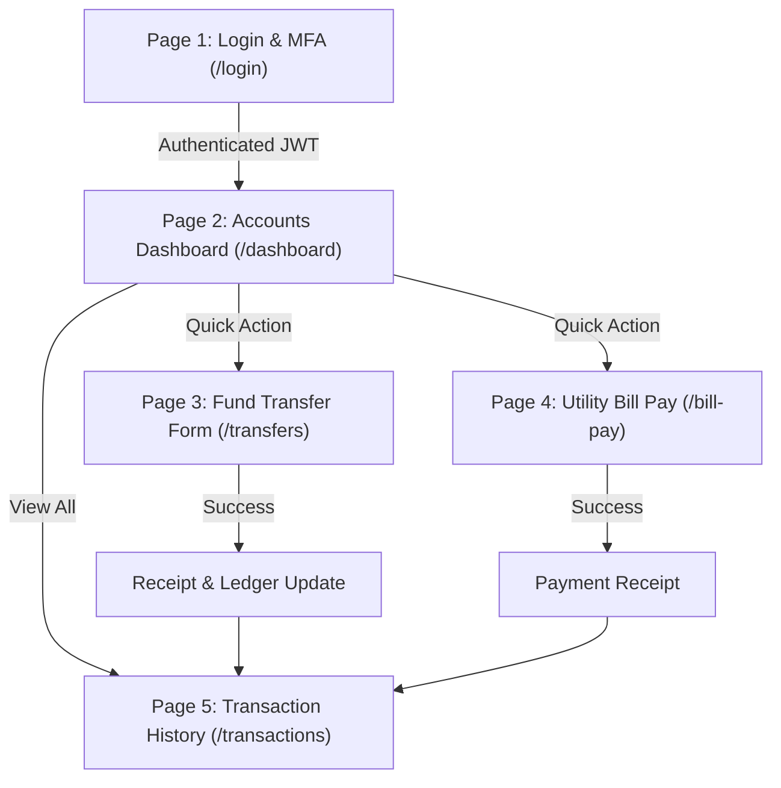

# FinApex Digital Banking - UI/UX Wireframes & Figma Design Specification

**Target Platform:** Responsive Web & Desktop (1440px desktop frame, 768px tablet, 375px mobile)  
**Design System Name:** FinApex Quantum Design System (Figma-ready)  
**WCAG Accessibility:** WCAG 2.1 AA Compliant (Contrast ratio >= 4.5:1)  

---

## 1. Design System Tokens & Figma Style Guide

### 1.1 Color Tokens
| Token Name | Hex Code | Usage |
| :--- | :--- | :--- |
| `primary-900` | `#0B192C` | Deep Navy (Sidebar, App header, text-dark) |
| `primary-600` | `#1E3E62` | Brand Primary (Buttons, active tabs, links) |
| `accent-500`  | `#FF6500` | Accent CTA (Primary submit, transfer action) |
| `neutral-50`  | `#F8FAFC` | App canvas background |
| `neutral-100` | `#F1F5F9` | Card background, input inactive borders |
| `neutral-700` | `#334155` | Secondary text, labels |
| `neutral-900` | `#0F172A` | Primary typography |
| `success-600` | `#16A34A` | Completed transactions, positive balances |
| `danger-500`  | `#DC2626` | Error states, validation banners, negative limits |
| `warning-500` | `#F59E0B` | Pending status, warning callouts |

### 1.2 Typography (Inter / Roboto)
- **Display 1:** `32px / Bold (700)` - Dashboard headline, account summary.
- **Heading 2:** `24px / SemiBold (600)` - Page headers, form section titles.
- **Body Regular:** `14px / Regular (400)` - Form labels, table cells, descriptions.
- **Body Bold / Caption:** `12px / Medium (500)` - Validation helper text, tags, badges.

### 1.3 Figma Layout Grid
- **Desktop (1440px):** 12 Columns, Margin `80px`, Gutter `24px`.
- **Sidebar Navigation:** Fixed width `260px`.
- **Main Container:** Max width `1120px` centered.

---

## 2. Mermaid Information Architecture & User Flow



---

## 3. High-Fidelity Wireframes (Screen-by-Screen Layout)

### Screen 1: Login & Authentication (`/login`)
```
+-----------------------------------------------------------------------+
|  FinApex Secure Banking                                   [Help / FAQ] |
+-----------------------------------------------------------------------+
|                                                                       |
|                     +-------------------------------+                 |
|                     |       [FinApex Logo]          |                 |
|                     |     Welcome Back, Sign In     |                 |
|                     |                               |                 |
|                     | Email / Username              |                 |
|                     | [ john.doe@bank.com         ] |                 |
|                     | (x) Valid format              |                 |
|                     |                               |                 |
|                     | Password                      |                 |
|                     | [ ****************        [o] ]|                |
|                     | (x) Min 8 chars, 1 num, 1 spec|                 |
|                     |                               |                 |
|                     | [X] Remember Me               |                 |
|                     |                               |                 |
|                     |  +-------------------------+  |                 |
|                     |  |   [ Log In Securely ]   |  |                 |
|                     |  +-------------------------+  |                 |
|                     |                               |                 |
|                     | Quick Test Credential Autofill|                 |
|                     | [Fill John Doe] [Fill Jane S] |                 |
|                     +-------------------------------+                 |
|                                                                       |
+-----------------------------------------------------------------------+
```

### Screen 2: Accounts Overview Dashboard (`/dashboard`)
```
+-----------------------------------------------------------------------+
| [FinApex]   Dashboard   Transfers   Bill Pay   History   | [John Doe v]|
+-----------------------------------------------------------------------+
|                                                                       |
|  Total Net Balance: $66,571.25 USD        [+ Transfer]  [Pay Bill]   |
|                                                                       |
|  +--------------------+  +--------------------+  +------------------+ |
|  | Checking Account   |  | High Yield Savings |  | Platinum Credit  | |
|  | ACC: **** 8471     |  | ACC: **** 8239     |  | ACC: **** 2374   | |
|  | $14,250.75         |  | $48,920.00         |  | Available $3.4k  | |
|  | Status: [ACTIVE]   |  | Status: [ACTIVE]   |  | Status: [ACTIVE] | |
|  +--------------------+  +--------------------+  +------------------+ |
|                                                                       |
|  Recent Activity (Last 5 Transactions)                 [View All ->]  |
|  +------------------------------------------------------------------+ |
|  | Date       | Description          | Type     | Amount    | Status| |
|  | 2026-10-08 | Alice Walker         | Transfer | -$350.00  | DONE  | |
|  | 2026-10-06 | ConEd Electricity    | Utility  | -$145.80  | DONE  | |
|  +------------------------------------------------------------------+ |
+-----------------------------------------------------------------------+
```

### Screen 3: Fund Transfer & Payment Form (`/transfers`)
```
+-----------------------------------------------------------------------+
| [FinApex]   Dashboard   [Transfers]   Bill Pay   History | [User Profile]
+-----------------------------------------------------------------------+
|                                                                       |
|  FUND TRANSFER FORM                                                   |
|  Send money securely with instant balance validation                  |
|                                                                       |
|  1. Select Source Account *                                           |
|  [ Checking Account - **** 8471 (Avail: $14,250.75)             [v] ] |
|                                                                       |
|  2. Beneficiary Account Number *                                      |
|  [ 4491029384                                                     ]   |
|  (!) Error state if < 10 digits or equals source account              |
|                                                                       |
|  3. Routing / ABA Number *                                            |
|  [ 021000021                                                      ]   |
|  (!) Must be exactly 9 digits                                         |
|                                                                       |
|  4. Transfer Amount ($) *                                             |
|  [ $ 250.00                                                       ]   |
|  Available Limit: $10,000.00/day | Balance: $14,250.75                |
|  (!) Error if amount > balance or amount <= 0                         |
|                                                                       |
|  5. Purpose / Remarks *                                               |
|  [ Consulting payment for project milestone                       ]   |
|                                                                       |
|  +------------------------------------------------------------------+ |
|  |                   [ Review & Confirm Transfer ]                  | |
|  +------------------------------------------------------------------+ |
+-----------------------------------------------------------------------+
```

### Screen 4: Utility Bill Payment Form (`/bill-pay`)
```
+-----------------------------------------------------------------------+
| [FinApex]   Dashboard   Transfers   [Bill Pay]   History | [User Profile]
+-----------------------------------------------------------------------+
|                                                                       |
|  UTILITY BILL PAYMENT                                                 |
|                                                                       |
|  Select Category:                                                     |
|  [ (•) Electricity  ( ) Water  ( ) Fiber Internet  ( ) Mobile Recharge]|
|                                                                       |
|  Select Service Provider *                                            |
|  [ Consolidated Edison Power                                    [v] ] |
|                                                                       |
|  Consumer Account Number *                                            |
|  [ ELEC-982341                                                    ]   |
|  Rule: ELEC- followed by 6 numeric digits                             |
|                                                                       |
|  Bill Due Date *                                                      |
|  [ 2026-10-25                                                   [D] ] |
|                                                                       |
|  Payment Amount ($) *                                                 |
|  [ $ 145.80                                                       ]   |
|                                                                       |
|  [X] Setup monthly auto-pay for this biller                           |
|                                                                       |
|  +------------------------------------------------------------------+ |
|  |                        [ Pay Bill Now ]                          | |
|  +------------------------------------------------------------------+ |
+-----------------------------------------------------------------------+
```

### Screen 5: Transactions Audit & Statement (`/transactions`)
```
+-----------------------------------------------------------------------+
| [FinApex]   Dashboard   Transfers   Bill Pay   [History] | [User Profile]
+-----------------------------------------------------------------------+
|                                                                       |
|  TRANSACTION HISTORY & AUDIT STATEMENT                                |
|                                                                       |
|  Filters & Search:                                                    |
|  From: [2026-09-01]  To: [2026-10-09]  Type: [ALL v]  Min: [$0 ] Max: [$5k]
|  [Search description / ref ID...]              [Filter]  [Export CSV] |
|  (!) Error banner if From Date > To Date                              |
|                                                                       |
|  +------------------------------------------------------------------+ |
|  | Ref #        | Date       | Recipient/Memo    | Type     | Amount| |
|  | TXN-1001-001 | 2026-10-01 | Alice Walker      | TRANSFER | $350  | |
|  | TXN-1003-002 | 2026-10-03 | ConEd Power       | BILL_PAY | $145  | |
|  | TXN-1004-003 | 2026-10-04 | Apex Landlords    | TRANSFER | $2100 | |
|  +------------------------------------------------------------------+ |
|  Showing 1 - 10 of 48 transactions             [< Prev] [1] [2] [Next>]
+-----------------------------------------------------------------------+
```

---

## 4. Figma Implementation Guide & Component Auto-Layout

To import and build this in Figma:
1. **Frame Setup:**
   - Create Parent Frame: `FinApex Desktop` (`1440w` x `1024h`, background `#F8FAFC`).
2. **Auto-Layout Button Component:**
   - Name: `Button/Primary`
   - Padding: Horizontal `20px`, Vertical `12px`, Border Radius `8px`.
   - Fill: `#FF6500` (Default), `#E05700` (Hover), `#94A3B8` (Disabled).
   - Text: `14px / SemiBold`, Fill `#FFFFFF`.
3. **Form Input Field Component:**
   - Variants: `State = Default | Focused | Error | Success`.
   - Frame: Width `100%`, Height `48px`, Padding `12px 16px`, Corner Radius `6px`.
   - Stroke: `1px solid #CBD5E1` (Default), `2px solid #DC2626` (Error), `2px solid #1E3E62` (Focus).
   - Sub-layer: Helper / Error text frame below input (`12px / Medium`, `#DC2626`).
4. **Interactive Modal:**
   - Overlay: `#000000` with 50% opacity backdrop blur `4px`.
   - Card Frame: `480px` width, `Padding 32px`, Elevation Shadow `0px 20px 25px -5px rgba(0,0,0,0.1)`.
